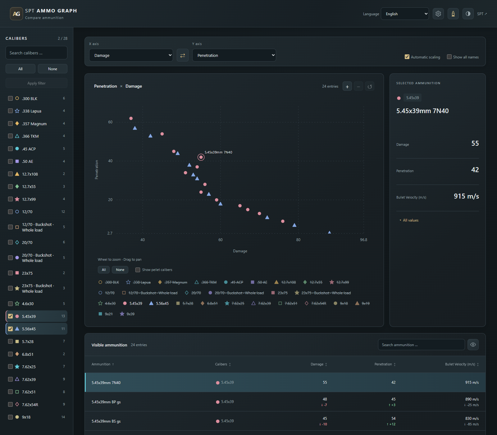

# SPT Ammo Graph

AmmoGraph is a server mod for **SPT 4.1.4 and later / .NET 10**. It displays the ammunition loaded by your SPT installation at `/AmmoGraph`, including changes made by other mods that finish before AmmoGraph captures the data during startup. It has been tested in both clean and modded SPT installations.

Filter calibers, plot ammunition statistics, and compare cartridges. The page runs inside the existing SPT web server. No additional client mod, Python export, or separate web server is required.

The header cartridge button opens a ballistics simulator: build a mixed magazine of 1–100 rounds (30 by default), configure armor and inserts, and inspect penetration rate, armor wear and damage over 2,000 magazine runs. Magazine capacity and equipment stay selected when changing caliber. Buckshot supports a configurable mean pellet hit percentage, with at least one pellet hitting per shot. The chart supports horizontal zoom and pan within the displayed shot range, keeps both vertical scales fully visible, marks the shot where cumulative mean damage reaches 85 chest HP, and can show or hide subsequent shots. It models inspected game formulas with loaded server values; client code patches and full Unity hit geometry are outside its scope. See [Ballistics simulator](docs/simulation.md).



## Documentation

| I want to … | Read |
| --- | --- |
| use and configure the application | [Usage and configuration](docs/usage.md) |
| understand Shots to Kill values and reference armor | [Shots to Kill](docs/shots-to-kill.md) |
| review changes after v0.23.6 | [Cumulative release notes](docs/release-notes-since-0.23.6.md) |
| build magazines and simulate armor damage | [Ballistics simulator](docs/simulation.md) |
| explore each part of the interface through screenshots | [Interface tour](docs/ui.md) |
| understand the code as a new developer | [Developer guide](docs/development.md) |
| look up data flows, interfaces, and storage formats | [Interface reference](docs/interfaces.md) |
| run checks or update screenshots | [Testing and documentation maintenance](docs/testing.md) |

The documentation includes architecture, workflow, and interface diagrams. GitHub renders these Mermaid diagrams directly.

Release archives use **7z** and contain the relative path `SPT_Runtime/user/mods/AmmoGraph`. Copy the archive into your SPT root directory (the directory containing `SPT_Runtime`) and extract it there with the server stopped. Paths work across operating systems. All included files belong to the mod directory; documentation and the license are provided on GitHub. Existing configuration files are not included or overwritten. Build an archive with `./AmmoGraph/build.ps1 -Package`; packaging requires `7zz`, `7z`, or `7za`, or an explicit `-SevenZipPath`.

## Quick start

Requirements for building from source: the .NET 10 SDK and an existing SPT runtime containing the referenced server libraries. No additional client plugin or Realism mod is required. The default project paths expect this layout:

```text
Workspace/
├── AmmoGraph/
│   ├── AmmoGraph.csproj
│   └── build.ps1
└── SPT_Runtime/
    ├── SPTarkov.Server.Core.dll
    └── …
```

Stop the server before updating the mod DLL. Run this command from the shared workspace directory:

```powershell
./AmmoGraph/build.ps1 -Install
```

The script builds the mod and copies the DLL, debug symbols, and web files to `SPT_Runtime/user/mods/AmmoGraph`. It creates the two configuration files if they are missing and preserves existing files. Use `-RuntimePath 'C:/SPT/SPT_Runtime'` to select another runtime location.

Start the SPT server, then open **https://localhost:6969/AmmoGraph**, for example. The page is also linked from the SPT web panel. The address, port, HTTPS, and authentication follow your SPT configuration.

## Features and data

- Reads ammunition templates and translations once during server startup.
- Displays damage, penetration, velocity, and other statistics in the chart, table, and details panel.
- Evaluates [Shots to Kill against representative armor classes](docs/shots-to-kill.md) once per loaded dataset, with shared deterministic results.
- Supports zooming, panning, buckshot/pellet views, language selection, and light and dark themes.
- Fans out grouped chart points on hover, with dashed connectors and individual ammunition selection.
- Stores personal views, names, and exclusions in each visitor's browser.
- Leaves game values and profiles unchanged. The page does not write server configuration files.

The dataset does not refresh automatically after startup. Restart the server after changing server defaults or ammunition data. The interactive Blazor page requires a connection to the running SPT server. No external CDNs are loaded at runtime.

## Development

Start with [architecture and terminology](docs/development.md), continue with the [interfaces](docs/interfaces.md), then read about [testing](docs/testing.md). The examples explain how an SPT ammunition template becomes a chart point and where to add a new statistic.

Run the core checks from the shared workspace directory:

```powershell
dotnet run --project AmmoGraph/tests/Core -c Release
```

## Credits and license

Continues the idea behind [SPTRealismAmmoGraph](https://github.com/AcksBerg/SPTRealismAmmoGraph). Assemblies from an existing SPT installation are external build requirements.

The project code is available under the [MIT license](LICENSE).
