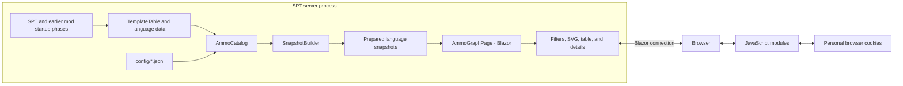
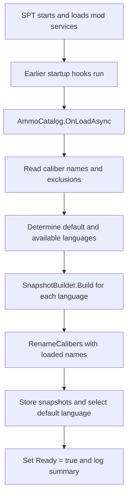
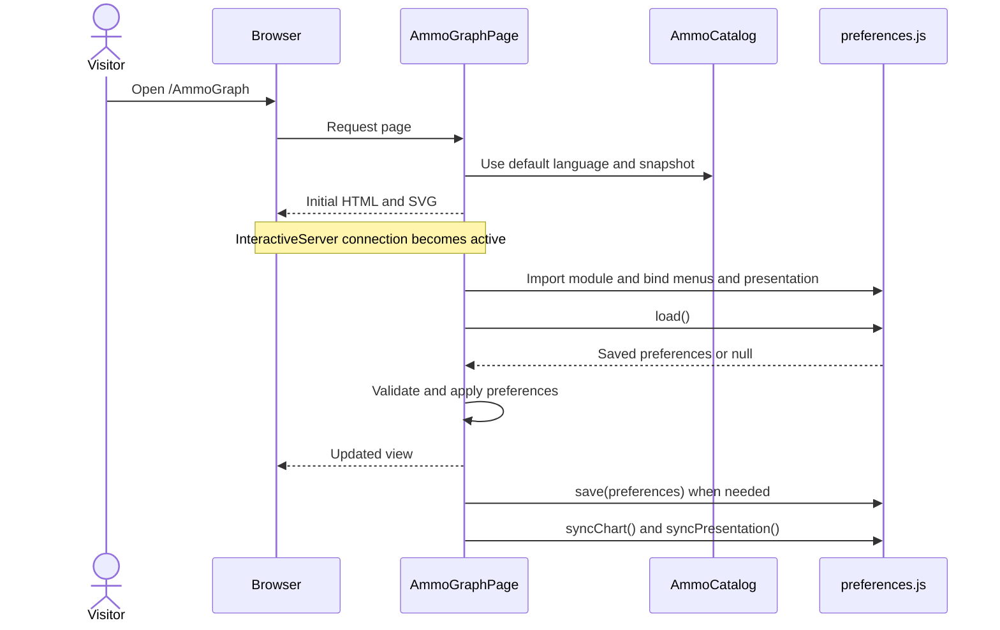
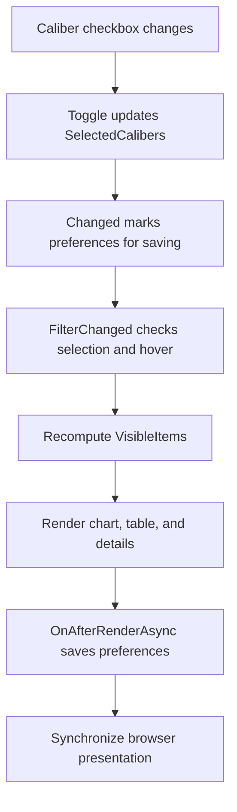

# Understanding the code

[Project overview](../README.md) · [Interface tour](ui.md) · [Interfaces](interfaces.md) · [Testing](testing.md)

This guide is for developers who know basic C# but have not worked on SPT mods or Blazor pages before. All paths are relative to the `AmmoGraph` directory.

## 1. The basic idea

At server startup, AmmoGraph reads the ammunition data already loaded by SPT. It prepares a dataset for each available language. Visitors then choose the calibers, statistics, and cartridges they want to see.

| Part | Responsibility | Code entry point |
| --- | --- | --- |
| Data preparation | Read SPT templates and prepare names and numbers | [Core/AmmoCatalog.cs](../Core/AmmoCatalog.cs), [Core/AmmoSnapshot.cs](../Core/AmmoSnapshot.cs) |
| User interface | Display filters, chart, table, and details | [Web/AmmoGraphPage.razor](../Web/AmmoGraphPage.razor) |
| Browser behavior | Handle cookies, zoom, tooltip positioning, and drag gestures | [wwwroot/preferences.js](../wwwroot/preferences.js), [wwwroot/navigation.js](../wwwroot/navigation.js) |

A `.razor` file combines HTML with C#. For example, `@foreach` generates one table row for each cartridge. Its `@code` section contains the component's state and methods.

## 2. Terms used in the code

| Term | Meaning in this project |
| --- | --- |
| Template | An item definition loaded by SPT, with an ID and properties. |
| Snapshot | A prepared ammunition dataset for one language. |
| Singleton | One service instance shared by the entire server process. `AmmoCatalog` is a singleton. |
| Dependency injection (DI) | SPT supplies the services a class needs automatically. This is how `AmmoCatalog` receives its tables and services through its constructor. |
| Blazor component | A reusable part of the interface implemented in a `.razor` file. |
| InteractiveServer | The interface's C# code runs on the server. Events and display updates travel over the Blazor connection. |
| Rendering | Creating or updating the visible interface from its current state. |
| JavaScript interop | Calls between C# and JavaScript, such as reading browser cookies. |
| Metric | A numeric field such as `Damage`, described by a key, label, and unit. |
| SVG | An image format built from geometric elements. AmmoGraph uses it to draw the chart without an additional chart library. |
| FrozenDictionary | A dictionary that cannot be changed after creation. The project uses it for metric values and language snapshots, among other things. |

## 3. Architecture and data flow



All visitors share the catalog. Selection, language, and personal names belong to the state of each interactive page. Browser cookies allow that state to be restored later. Personal names produce a derived view without overwriting the shared catalog.

## 4. Finding your way around the repository

| File or directory | What it contains |
| --- | --- |
| [Metadata.cs](../Metadata.cs) | Mod name, version, supported SPT range, web asset path, and home page. |
| [AmmoGraph.csproj](../AmmoGraph.csproj) | .NET target, SPT references, and embedded resources. `tests` and `tools` are excluded from the mod build. |
| [build.ps1](../build.ps1) | Release build and optional installation. |
| [Core/AmmoCatalog.cs](../Core/AmmoCatalog.cs) | Startup entry point and access to language snapshots. |
| [Core/AmmoSnapshot.cs](../Core/AmmoSnapshot.cs) | Data models, template selection, metrics, percentage conversion, and buckshot variants. |
| [Core/CaliberNameMap.cs](../Core/CaliberNameMap.cs) | Loading and overriding caliber names. |
| [Core/DefaultExclusions.cs](../Core/DefaultExclusions.cs) | Reading default exclusions and identifying matching templates. |
| [Core/AmmoSearch.cs](../Core/AmmoSearch.cs) | Shared search normalization and matching. |
| [Core/AmmoComparison.cs](../Core/AmmoComparison.cs) | Comparison delta, arrow direction, and rating. |
| [Core/ChartAxis.cs](../Core/ChartAxis.cs) | Axis bounds and tick marks. |
| [Core/UiText.cs](../Core/UiText.cs) | Interface translations, language codes, number culture, and text direction. |
| [Web/GraphLayout.razor](../Web/GraphLayout.razor), [Web/GraphStyles.cs](../Web/GraphStyles.cs) | Page layout and embedded CSS emitted before the page content. |
| [Web/AmmoGraphPage.razor](../Web/AmmoGraphPage.razor) | Page state, filters, reference selection, and interface composition. |
| [Resources](../Resources) | Embedded JSON files for translations and default configuration. |
| [wwwroot](../wwwroot) | CSS and JavaScript copied as web assets during installation. |
| [tests](../tests) | C# check program, Playwright checks, and a separate startup test mod. |
| [tools/Inspect](../tools/Inspect) | Utility for examining the locally installed .NET interfaces. |

## 5. Server startup workflow



`AmmoCatalog` implements `IOnLoad` and is registered with `[Injectable(InjectionType.Singleton, int.MaxValue)]`. The high priority makes this hook run after ordinary earlier hooks. Changes from a mod with the same priority or one that modifies data later are not guaranteed to be included.

`OnLoadAsync` reads the JSON configuration beside the installed DLL. It first creates `_baseSnapshots` without the configured display names, then derives `_snapshots` with the effective caliber names. The base snapshots allow a visitor to suppress a name mapping personally and fall back to the base label.

`Ready` is set only after the dataset has been built. Until then, the page shows a loading message. There is no automatic rebuild after startup.

## 6. From a template to a chart point

The models are defined in [AmmoSnapshot.cs](../Core/AmmoSnapshot.cs):

```csharp
public sealed record AmmoMetric(string Key, string Label, string Unit = "");
public sealed record AmmoSnapshot(
    string Language,
    IReadOnlyList<AmmoEntry> Items,
    IReadOnlyList<AmmoMetric> Metrics);
```

`AmmoEntry` represents one displayable variant. Its fields include `Id`, `Name`, `CaliberId`, `Caliber`, and `Values`. See the [interface reference](interfaces.md) for the complete field descriptions.

For a simple example, suppose SPT provides a cartridge with `Damage = 50`, `PenetrationPower = 30`, and `RicochetChance = 0.2`.

1. `SnapshotBuilder.Build` accepts the template if `AmmoType` is `bullet` or `buckshot` and a caliber is present.
2. It reads the name from the selected game language, falls back to English, and finally uses the template name.
3. The metric catalog determines which properties to read. The code finds them with `typeof(TemplateItemProperties).GetProperty(...)`. Looking up a property by its name is called reflection.
4. `RicochetChance` is multiplied by 100 for display: `0.2` becomes `20%`. Damage and penetration remain `50` and `30`.
5. The page filters the entries and draws a point at `(50, 30)` when X is damage and Y is penetration.

A missing or non-finite number becomes `null`. The table displays it as `—`. An entry without a valid X or Y value does not produce a point. Entries with identical coordinates share a point group.

### Buckshot needs two views

A `buckshot` template produces two views: the whole load and one pellet. For eight pellets dealing 30 damage each, the load has `Damage = 240` and the pellet view has `Damage = 30`. Both retain a projectile count of 8. The load total assumes every pellet hits; it does not simulate an actual hit.

The pellet ID gains a `:pellet` suffix, while caliber groups gain `:shot` and `:pellet`. `TemplateId` removes the variant suffix again. A personal ammunition exclusion therefore hides both views of the same template.

## 7. Opening the page



`OnInitialized` first applies the defaults. Browser data can only be read through JavaScript after interactive rendering. `OnAfterRenderAsync` therefore loads the cookies and applies settings such as language, columns, and exclusions. Once restoration is complete, the DOM contains `data-ready="true"`; browser checks wait for this marker too.

The rendering mode is declared at the top of the page with `@rendermode InteractiveServer`. The page therefore needs a connection to the running server.

## 8. What happens when a filter changes



`VisibleItems` combines personal exclusions, pellet visibility, caliber selection, and ammunition search. Ammunition search applies only while the table is visible. Caliber search initially narrows the filter list; only **Apply filter** replaces the current caliber selection with the matching entries.

`FilterChanged` clears the reference selection if that ammunition is no longer visible. The table and details cannot accidentally keep comparing against a hidden reference.

Automatic axis scaling uses the plotted entries. Global scaling uses all allowed entries with values for both axes, respecting exclusions and pellet visibility. `ChartAxis.Create` calculates bounds and tick marks from these values.

## 9. Smaller components

The main page owns the state. Child components receive values through `[Parameter]` and report changes through `EventCallback`. For example, `ColumnPicker` receives the selected columns and reports a click through `OnToggle`. The page then updates `TableColumns`.

| Component | Responsibility |
| --- | --- |
| [ExclusionEditor](../Web/ExclusionEditor.razor) | Settings menu, view options, and exclusion lists; accepts additional settings sections as child content. |
| [AttributePicker](../Web/AttributePicker.razor) | Add, remove, and reorder metrics; uses JavaScript for drag and drop. |
| [CaliberNameEditor](../Web/CaliberNameEditor.razor) | Save, suppress, and reset personal display names. |
| [ColumnPicker](../Web/ColumnPicker.razor) | Choose visible table columns. |
| [TableValue](../Web/TableValue.razor) | Display a table value and its difference from the reference. |
| [ComparedValue](../Web/ComparedValue.razor) | Display reference, candidate, and delta in the details panel. |
| [CaliberSymbol](../Web/CaliberSymbol.razor), [CaliberMarker](../Web/CaliberMarker.razor) | Shared symbol shapes for lists and chart points. |
| [ThemePicker](../Web/ThemePicker.razor), [MenuIcon](../Web/MenuIcon.razor) | Theme toggle and menu icons. |

JavaScript handles frequent browser movements. Zooming updates SVG positions and axes locally, without a Blazor call for every animation frame. Selecting a cartridge remains a Blazor event and changes the page's `SelectedId`.

## 10. Making your first changes

### Add a new metric

1. Check the exact property name and type in `TemplateItemProperties`. `SnapshotBuilder` expects an existing property that can be converted to a number; a wrong name can cause snapshot creation to fail.
2. Add an `AmmoMetric` to the metric list in `SnapshotBuilder.Build`. Use the property name as its `Key` and supply a unit if needed.
3. Add the label to the translation resources loaded by `UiText`. For resources using `|`-separated text, key and value lists must remain the same length.
4. Check the numeric unit: only percentages stored as fractions belong in `FractionalPercentages`. A value already stored as a percentage must not be multiplied again.
5. Decide in `AmmoComparison.Create` whether higher or lower values are better. Without a mapping, the rating stays neutral.
6. Change the default lists in `AmmoGraphPage` only if the metric should appear by default. The catalog already makes new metrics available in the selection controls.
7. Check data preparation and comparisons in the C# check program, then selection, units, and rendering in the browser. See [testing](testing.md).

### Change interface text

Find the text key in `UiText` and `Resources`, then update its translation in the appropriate JSON catalog. These files are embedded in the DLL, so rebuild and install the mod and restart the server.

### Add a personal preference

Add the page state and the field in the `Preferences` record, then update restoration and saving in `OnAfterRenderAsync`. Also update `valid()` in `preferences.js`. Older cookies will not contain the field: make it optional with a sensible default to keep those settings readable. Check restoration in a fresh browser context and after a reload.

### Change CSS

Edit `wwwroot/graph.css`. `GraphStyles` reads the same file as an embedded resource so that even the first HTML response is styled. Replacing the installed CSS file alone is not sufficient: rebuild and install the DLL, then restart the server.

## 11. Common problems

The [ballistics simulator guide](simulation.md) explains the additional `SimulationCatalog`, `MagazineRecipe`, `BallisticsEngine` and simulator components. The catalog reads templates, presets and globals in the same startup phase; calculation runs on a background task against captured inputs. The simulator does not load Unity or client assemblies.

| Symptom | Check first |
| --- | --- |
| Adding a metric prevents startup | Exact property name in `TemplateItemProperties`, numeric type, and complete translation lists. |
| A percentage is 100 times too large | Is the raw value already a percentage? Is `FractionalPercentages` normalizing it unnecessarily? |
| A configuration change does not appear | Edit the installed file beside the DLL and restart the server; personal names can override it. |
| A cartridge is missing from the chart | Exclusions, caliber selection, pellet toggle, ammunition search, and missing axis values. |
| Language or columns change after loading | Saved browser preferences are applied after the initial render. |
| Gestures fire more than once after navigation | JavaScript event listeners must be removed in `DisposeAsync` or the unbind functions. |

The [interface reference](interfaces.md) describes the data contracts and browser attributes in detail.
