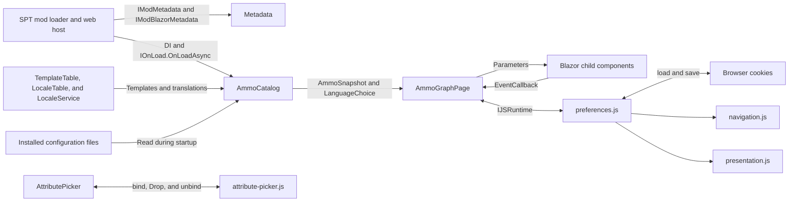
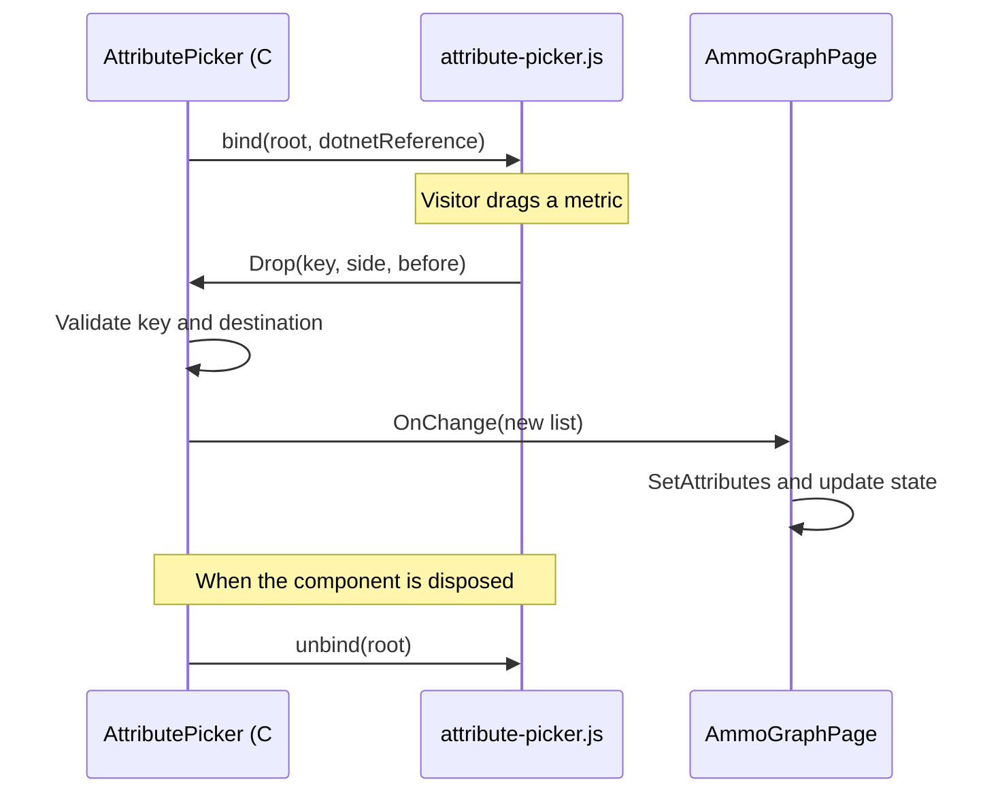

# Interfaces and data contracts

[Project overview](../README.md) · [Developer guide](development.md)

An interface describes what data one part of the application receives from another and which calls it supports. AmmoGraph uses SPT interfaces, internal C# models, Blazor components, and JavaScript calls. The mod does not define its own REST API for reading or changing ammunition data.

## 1. Interface overview



The configuration flow represents read access by the mod. Personal changes in the browser pass through page state into cookies.

The simulator adds `SimulationCatalog`, captured in the same startup hook from templates, presets and globals. `SimulatorDraft` contains caliber, `MagazineRecipe`, armor ID, slot choices, zone and seed. `SimulationRequest` supplies that draft and a run count to the server-side `BallisticsEngine`; `SimulationResult` contains per-shot means, component durability and an example trace. There is no simulation REST API or client bridge. Optional `simulationMode` and `simulator` preferences keep older cookies compatible. See [the simulator guide](simulation.md).

`SimulatorWorkspace` shares magazine capacity, equipment, and `SimulatorDraft.PelletHitPercent` across calibers while retaining separate ammunition patterns. Capacity ranges from 1–100. The pellet percentage ranges from 0–100 and defaults to 100 in older preferences. `ShotStatistics.MeanPelletHits` reports the sampled mean; `ExampleShot.PelletHits` reports the example's actual count. Only hitting projectiles are processed by the damage and armor calculations, with a minimum of one hit per cartridge.

`AmmoEntry.ShotsToKill` holds shared per-template result dictionaries keyed by `ShotsToKillClassN`. `ShotsToKillResult` separates `Success` (positive integer `Shots`), `Capped` (no numeric value) and `Failed`; absence remains distinct. `SnapshotBuilder.Value` returns coordinates only for successful results. `ShotsToKillEvaluation.Comparer` orders successful values ascending, then capped outcomes, then missing/failed values. `AmmoComparison.HasNumericDelta` is false for capped comparisons, so UI components show direction and tone without a fabricated numeric difference. See [reference armor evaluation](shots-to-kill.md).

## 2. SPT registration

Sources: [Metadata.cs](../Metadata.cs), [AmmoCatalog.cs](../Core/AmmoCatalog.cs).

| Contract | Implementation | Purpose |
| --- | --- | --- |
| `IModMetadata` | `Metadata` | Mod GUID `com.acksberg.ammograph`, name `AmmoGraph`, version `0.25.1`, MIT license, and SPT compatibility `>=4.1.4`. |
| `IModBlazorMetadata` | `WWWRootUrl = "ammo-graph"`, `HomePage = "/AmmoGraph"` | SPT serves the web assets and links to the mod page. |
| `IOnLoad` | `AmmoCatalog.OnLoadAsync(CancellationToken)` | Build the dataset once during server startup. |
| `[Injectable(...)]` | `Singleton`, priority `int.MaxValue` | One shared catalog, running after ordinary earlier startup hooks. |

`AmmoCatalog` receives five dependencies through its constructor:

| Dependency | Data read or functionality used |
| --- | --- |
| `TemplateTable` | `Items.Values`: loaded item templates, including mod changes. |
| `GlobalTable` | Loaded armor class resistances, material factors, body-collider settings and equipment presets for simulation. |
| `LocaleTable` | Available game language databases through `Global.Keys`. |
| `LocaleService` | Desired server language, supported languages, and translation tables. |
| `ISptLogger<AmmoCatalog>` | Configuration warnings and a summary after dataset creation. |

References to these SPT types come from the local runtime; see [AmmoGraph.csproj](../AmmoGraph.csproj). `Private=false` prevents the server assemblies from being copied into the mod build output.

## 3. Web paths

| Path | Purpose |
| --- | --- |
| `/AmmoGraph` | Blazor page using `InteractiveServer`. |
| `/ammo-graph/preferences.js` | Cookies, menus, and re-exports of chart and presentation functions. |
| `/ammo-graph/navigation.js` | Local zoom and pan for the SVG chart. |
| `/ammo-graph/presentation.js` | Tooltip positioning, layout sizing, and a theme helper. |
| `/ammo-graph/attribute-picker.js` | Drag and drop for metric lists. |
| `/ammo-graph/graph.css` | Installed CSS file; the layout also emits CSS content embedded in the DLL. |

JavaScript imports use version parameters such as `?v=21`. When changing a module, check whether the affected import paths need a cache version update. The existing Blazor web host handles communication for the interactive C# code.

## 4. Internal C# contracts

Source: [AmmoSnapshot.cs](../Core/AmmoSnapshot.cs).

| Model / field | Type | Meaning |
| --- | --- | --- |
| `AmmoSnapshot.Language` | `string` | Normalized display language code, such as `en`. |
| `AmmoSnapshot.Items` | `IReadOnlyList<AmmoEntry>` | All prepared ammunition variants for the language, including variants hidden by default. |
| `AmmoSnapshot.Metrics` | `IReadOnlyList<AmmoMetric>` | Metric definitions in catalog order. |
| `AmmoEntry.Id` | `string` | Variant ID: the template ID, or the template ID with `:pellet`. |
| `AmmoEntry.TemplateId` | `string` | Computed original template ID without the variant suffix. |
| `AmmoEntry.Name` | `string` | Localized ammunition name, with fallback rules. |
| `AmmoEntry.CaliberId` | `string` | Internal group key, with `:shot` or `:pellet` for buckshot. |
| `AmmoEntry.Caliber` | `string` | Displayed caliber name, used for labels and search. |
| `AmmoEntry.IsBuckshot` / `IsPellet` | `bool` | Flags identifying buckshot and pellet views. |
| `AmmoEntry.Values` | `FrozenDictionary<string, double?>` | Numbers indexed by metric key; missing or non-finite values become `null`. |
| `AmmoEntry.DefaultHiddenReason` | `string?` | Ammunition-level default exclusion reason, such as `Unused`, `Airsoft`, or `Configured`; does not delete data. Caliber exclusions are checked separately. |
| `AmmoEntry.ShotsToKill` | `IReadOnlyDictionary<string, ShotsToKillResult>?` | Shared per-template results; keys have the form `ShotsToKillClassN`. Whole-load and pellet variants use the same results. |
| `ShotsToKillResult` | `State`, `Shots`, `SuccessfulRuns` | Success has an integer shot count; capped and failed results have no numeric count. |
| `AmmoMetric.Key` | `string` | A template property such as `Damage`, or a calculated key such as `ShotsToKillClass6`. |
| `AmmoMetric.Label` / `Unit` | `string` | Translated name and unit. `DisplayLabel` appends the unit in parentheses. |

Important methods:

| Method | Input → result |
| --- | --- |
| `AmmoCatalog.GetSnapshot(language)` | Language → view with configured names; an unknown language falls back to the default. |
| `AmmoCatalog.GetBaseSnapshot(language)` | Language → base view for personal name overrides. |
| `SnapshotBuilder.Build(...)` | Templates, language, translations, and optional names/rules → snapshot. |
| `SnapshotBuilder.RenameCalibers(source, names)` | Existing snapshot and name map → derived snapshot. |
| `SnapshotBuilder.Value(ammo, key)` | Entry and metric → number or `null`. |
| `CaliberNameMap.WithOverrides(configured, personal)` | Server names and personal changes → effective name map. A personal `null` suppresses a mapping. |
| `AmmoSearch.Matches(query, values)` | Search query and display texts → case-insensitive match; dots and `/` are removed, and `×` becomes `x`. |
| `ChartAxis.Create(values)` | Finite numbers → lower/upper bounds and tick marks; empty input uses 0 to 1. |
| `AmmoComparison.Create(baseline, candidate, key)` | Reference, candidate, and metric → delta, arrow, and color class; returns `null` if a value is missing. |

Percentages are normalized in the snapshot. The table, axes, and comparisons use the same numbers. The difference between two percentages is expressed in percentage points. `AmmoComparison.Delta` is meaningful only when `HasNumericDelta` is true. For numeric comparisons it is `candidate − reference`; its rating also depends on whether higher or lower values are better.

## 5. C# ↔ JavaScript

Sources: [AmmoGraphPage.razor](../Web/AmmoGraphPage.razor), [preferences.js](../wwwroot/preferences.js).

| Call | Return value | Responsibility |
| --- | --- | --- |
| `load()` | Preferences object or `null` | Read and validate cookies; migrate old localStorage settings when applicable. |
| `save(value)` | `boolean` | Encode preferences and write cookies. Returns `false` on error or if too many chunks are needed. The page currently does not act on the result. |
| `bindMenus()` / `unbindMenus()` | None | Handle outside clicks, Escape, and menu positioning; remove listeners when unbound. |
| `syncChart()` / `destroyChart()` | None | Initialize/update SVG navigation or clean it up; re-exported from `navigation.js`. |
| `bindPresentation()` / `syncPresentation()` / `unbindPresentation()` | None | Set up, refresh, and remove tooltip and layout behavior; re-exported from `presentation.js`. |
| `oppositeTheme()` | `"light"` or `"dark"` | Return the opposite of the color scheme actually being displayed. |

The separate [AttributePicker](../Web/AttributePicker.razor) imports `attribute-picker.js`:



`Drop` is marked `[JSInvokable]`. `side` is `selected` or `available`; `before` is the next entry's key, or `null` to append. The C# method checks whether the metric exists in the available options.

When the page is disposed, `DisposeAsync` removes JavaScript listeners and releases module references. `JSDisconnectedException` handles a disconnected Blazor connection during cleanup.

## 6. Chart DOM contract

The DOM is the browser's tree of HTML and SVG elements. The main page writes `data-*` attributes into that tree, and `navigation.js` reads them. These attributes form an internal interface.

| Element / attribute | Contents and use |
| --- | --- |
| `.ag-chart`: `data-x-key`, `data-y-key`, `data-language` | Current metrics and number language used by navigation. |
| `.ag-chart`: `data-x-min`, `data-x-max`, `data-y-min`, `data-y-max` | Original data bounds supplied by C#. |
| `.ag-point`: `data-id` | Comma-separated IDs of overlapping variants. |
| `.ag-point`: `data-x`, `data-y` | The point's metric values. |
| `.ag-point`: `data-base-x`, `data-base-y` | Original SVG coordinates. JavaScript calculates movement relative to them. |
| `.ag-fan`: `data-group` | The same comma-separated member IDs as its collapsed point. `spiderfy.js` lays out the fan outside the clipped point layer. |
| `.ag-fan-point`: `data-id` | One ammunition ID with its own Blazor hover, focus, and selection handlers. |
| `.ag-fan-line` / `.ag-fan-origin` | Dashed links and the original data location in current SVG viewport coordinates. Fan positions never change ammunition values. |
| `.ag-static-axes`, `.ag-navigation-axes` | Axes prepared by C# and navigation axes generated locally. |
| `[data-nav="in"/"out"/"reset"]` | Zoom and reset buttons. |
| `.ag-chart`: `data-zoom`, `data-view-x-min`, etc. | Current viewport written by JavaScript; also used by browser checks. |

C# writes machine-readable numeric attributes using `InvariantCulture`, so a localized decimal comma does not break JavaScript number parsing. Visible labels use the selected display language instead.

Navigation compares metrics, language, bounds, and point data against the previous state. A change in this signature resets the viewport. A hover or selection change alone preserves it. Zoom and pan are not saved in cookies.

Navigation emits `ag-navigation-start` before camera movement or a data-signature reset. The fan controller collapses on that event. `syncFans` reconnects after Blazor renders; `destroyFans` releases its listeners during page disposal. Presentation handles individual fan members as tooltip anchors and places their cards outside the expanded area when space permits.

## 7. Server-wide JSON configuration

Installation directory: `SPT_Runtime/user/mods/AmmoGraph/config/`. Both files are read during server startup. Missing files use embedded defaults. Read or JSON errors produce a warning and fall back to defaults. Comments and trailing commas are allowed.

### caliber-names.json

```json
{
  "Caliber545x39": "5.45x39",
  "1036x77": ".408 Cheyenne"
}
```

This object maps caliber keys to display names. The `Caliber` prefix is optional, matching is case-insensitive, and `×` and `x` are equivalent. Entries extend or override the built-in mappings. Empty or non-string names are ignored. This file affects display names only.

### default-exclusions.json

```json
{
  "calibers": ["20x1mm", "26x75", "40x46"],
  "ammo": ["6241c316234b593b5676b637"],
  "nameContains": ["!!!DO_NOT_USE!!!"]
}
```

| Field | Contract |
| --- | --- |
| `calibers` | Internal caliber IDs with an optional `Caliber` prefix. Rules also cover their buckshot/pellet groups. |
| `ammo` | 24-character hexadecimal template IDs. Names are not accepted here. |
| `nameContains` | Substrings matched case-insensitively against internal or English names. |

A valid file replaces the built-in exclusion rules entirely. Missing fields are treated as empty lists; `{}` means no default exclusions. `null`, empty list entries, or invalid ammunition IDs cause a fallback to defaults. Exclusions affect visibility but do not remove templates from the snapshot.

## 8. Personal preferences and cookies

The C# contract is named `Preferences` and is defined in [AmmoGraphPage.razor](../Web/AmmoGraphPage.razor). JavaScript uses camelCase field names, such as `selectedId` for `SelectedId`.

| JavaScript fields | Stored state |
| --- | --- |
| `language`, `theme` | Language and `system`, `light`, or `dark` theme. |
| `calibers`, `xAxis`, `yAxis` | Selected caliber groups and active axis metrics. |
| `dynamicScale`, `showNames`, `showPellets` | Chart options. |
| `search`, `caliberSearch` | Ammunition and caliber search text. |
| `sortKey`, `descending`, `columns` | Table sorting and visible columns. |
| `selectedId` | Pinned reference ammunition or `null`. |
| `excludedCalibers`, `excludedAmmo` | Personally hidden groups and templates. |
| `includedDefaultAmmo`, `includedDefaultCalibers` | Default exclusions explicitly made visible again. These exceptions prevent automatic hiding on the next load. |
| `showFilters`, `showTable`, `showDetails` | Visible page sections. |
| `tooltipColumns`, `detailColumns`, `xColumns`, `yColumns` | Selected metrics and their order. Both axis lists are merged into a shared selection when loaded. |
| `caliberNames` | Object mapping normalized caliber keys to personal names; `null` suppresses a mapping. |
| `simAmmoNames` | Optional simulator shot names; missing values enable names. |
| `tableHeight` | Optional preferred table scroll height, 160-760 px; defaults to 360. |
| `simulationMode`, `simulator` | Existing active view and simulator draft. |
| `legacyWholeLoad` | Optional field for migrating old buckshot selections. |

`preferences.js` serializes the object as JSON, encodes it as UTF-8, then Base64. Base64 is a transport encoding. The cookie is named `spt-ammo-graph.v2`. Encoded data is split into chunks of up to 3,500 characters when necessary: the main cookie then contains `chunks:N`, and chunk cookies are named, for example, `spt-ammo-graph.v2.0`. At most eight chunks are allowed.

Cookies last one year, with `Path=/`, `SameSite=Lax`, and `Secure` when using HTTPS. A one-time migration reads `spt-ammo-graph.preferences.v1` from localStorage; the old entry is removed after a successful save. Unreadable or invalid preferences return `null`, allowing the page to use its defaults. C# also validates loaded metric keys, columns, names, and selections against the data actually available.

Personal renaming and exclusions write browser settings only. The page provides no call for changing `caliber-names.json`, `default-exclusions.json`, game values, or profiles.
