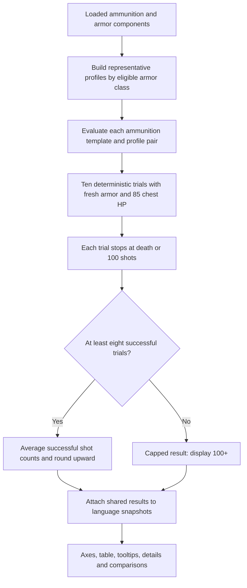

# Shots to Kill against reference armor

Available since v0.25.0; v0.25.1 excludes class 10 and removes the extra capped-results notice below the graph. See the [illustrated interface tour](ui.md#shots-to-kill) for English screenshots and [changes since v0.23.6](release-notes-since-0.23.6.md) for cumulative release notes.

A calculation error produces `Failed` (`—`) rather than a capped result. This startup workflow is separate from the visitor's interactive simulation.

[Project overview](../README.md) · [Simulator](simulation.md)

Each loaded armor class has a **Shots to Kill · Armor Class N** attribute. Add it through the attribute settings for graph axes, tooltips or details, or through the table column picker. Lower values indicate better ammunition performance.

Successful values are positive integers. `100+` means fewer than eight of ten runs killed the target within 100 shots. It has no numeric coordinate and ranks below every successful result, including a successful 100-shot kill. Two capped results compare equally. Missing or failed calculations display `—` and do not participate in performance comparisons.

Graph axes plot successful numeric values only. Capped values remain available in the table and details. Switching axes never converts a capped result into a coordinate of 100.

## Reference profiles

At startup, the loaded `SimulationCatalog.Parts` supply one eligible protection component per distinct template. Class 10 is excluded from reference profiles. Eligibility requires a positive class with a configured positive finite resistance, positive finite maximum durability, a resolved finite nonnegative material destructibility and finite blunt throughput between zero and one. UI filters and language choices do not affect eligibility.

Within each class, maximum durability, resolved destructibility and blunt throughput are averaged arithmetically, with equal weight per component. The class and its configured resistance remain unchanged. Each resulting profile is a single synthetic frontal chest plate (`Plate_Granit_SAPI_chest`) in front of `RibcageUp`. Armor starts at full durability in each run, with no additional soft insert or soft-armor blunt reduction.

## Evaluation and aggregation

Each distinct ammunition template is evaluated against each profile in exactly ten independent deterministic runs. Runs use seeds `12345 + runIndex * 104729` and the engine's fixed random stream. The existing separate pellet-hit stream uses the seed XOR `0x51ED270B`. Each shot fires only the evaluated cartridge: buckshot samples hits with `PelletHits` at 75% average hits, and single-projectile ammunition has one hit.

The batch path shares the interactive simulator's shot calculation, including penetration deviation, armor penetration, wear, fragmentation, blunt damage and immediate body damage. It sums immediate chest damage after each shot, stops that run at 85 HP, and never fires more than 100 shots. A kill on shot 100 succeeds; survival after shot 100 fails.

With eight or more successes, only successful shot counts enter the arithmetic mean, which is rounded upward with `Math.Ceiling`. With seven or fewer successes, no mean is calculated and the result is capped. This implements a success rate strictly greater than 75% of ten runs.

`AmmoCatalog` computes these results once during startup after capturing loaded mod data, before creating language snapshots. Frozen per-template result dictionaries are shared across visitors, languages, renamed calibers and buckshot/pellet display variants. A pellet display row still describes the cartridge's Shots to Kill. Restart the server to capture a changed dataset.

Batch evaluation allocates no chart series, per-shot statistics or example traces. The interactive simulator retains its original full-magazine behavior, selected pellet percentage and seed handling.

## Validation

`dotnet run --project AmmoGraph/tests/Core -c Release` covers success cutoffs, upward rounding, failed-run exclusion, shot-100 boundaries, sampled buckshot, shared snapshots, comparisons and both sorting directions. It compares optimized runs against complete simulator magazines for every loaded reference class.

For browser validation, start `AmmoGraph/tests/SimulationHost`, then run `node AmmoGraph/tests/shots-to-kill.mjs`. The test-only host exposes expected fixture values at `/test/shots-to-kill`; the production mod adds no endpoint. Checks cover all loaded templates, capped graph omissions, integer rendering, sorting, comparisons, tooltips, details, language changes and saved attributes.
