# Interface tour

[Project overview](../README.md) · [Usage](usage.md) · [Developer guide](development.md)

These screenshots were captured from the running local application using a separate temporary browser profile. They show the English interface in the dark theme. Available ammunition, values, and calibers depend on the installed mods. See [documentation maintenance](testing.md#updating-screenshots) to regenerate them.

## Overview

The header uses the original AmmoGraph logo on a white badge. Its border and shadow separate it from both theme backgrounds while keeping the black lettering and colored points visible.

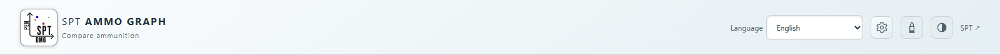

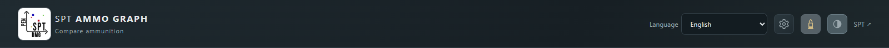

In the code: the logo is served from [wwwroot/AmmoGraph.png](../wwwroot/AmmoGraph.png), displayed by [AmmoGraphPage](../Web/AmmoGraphPage.razor), and styled by `.ag-brand-mark` in [graph.css](../wwwroot/graph.css).

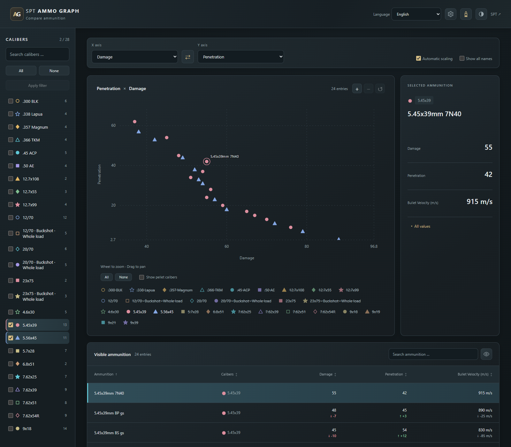

Language selection, settings, and the theme toggle are at the top. Choose calibers on the left, compare points in the center, and inspect a selected cartridge on the right. The table sits below the chart.

In the code, [AmmoGraphPage.razor](../Web/AmmoGraphPage.razor) assembles these sections. [GraphLayout.razor](../Web/GraphLayout.razor) supplies the page layout, and [graph.css](../wwwroot/graph.css) controls its sizing and appearance.

## Caliber filter

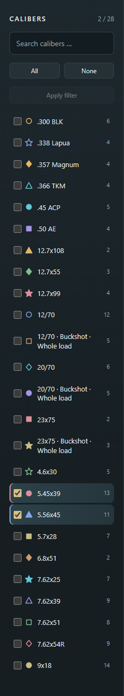

A checked box activates a caliber. Search narrows the displayed list; **Apply filter** makes the matches the new selection. Colors and symbols connect the list to the chart and table.

In the code: `SearchedCalibers`, `Toggle`, and `ApplyCaliberFilter` in [AmmoGraphPage](../Web/AmmoGraphPage.razor), with search rules in [AmmoSearch](../Core/AmmoSearch.cs).

## Chart and selected ammunition

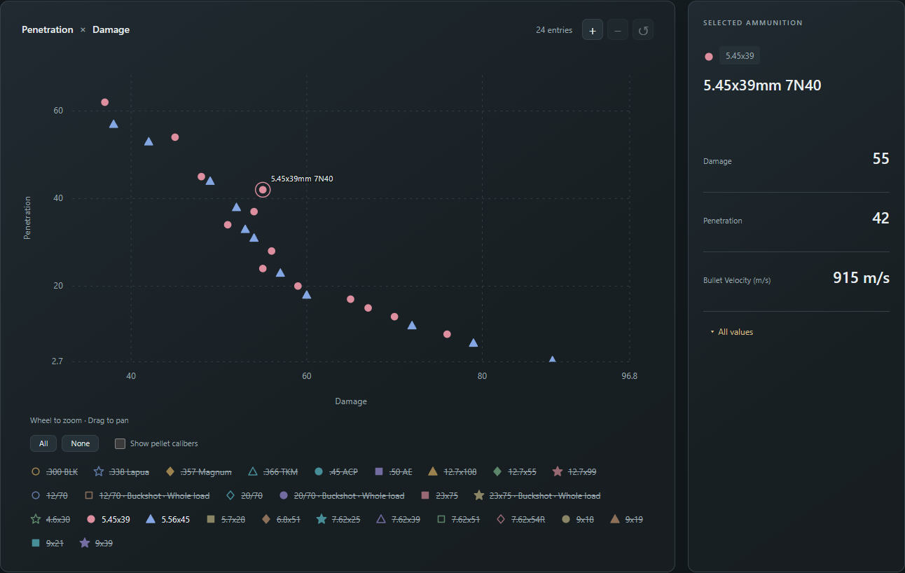

Each point represents at least one ammunition variant. Hovering a grouped point fans its cartridges out in a circle, with dashed connectors to their original shared position. Larger groups use several rings. Click an individual symbol to pin that cartridge as the comparison reference; hovering it shows its own tooltip and comparison values. The fan closes when you leave it, press Escape, or navigate the chart. Keyboard focus also opens it. Use the mouse wheel to zoom and drag to pan.

In the code: SVG fan members and `Select` in [AmmoGraphPage](../Web/AmmoGraphPage.razor), fan positioning and interaction in [spiderfy.js](../wwwroot/spiderfy.js), comparisons in [AmmoComparison](../Core/AmmoComparison.cs), local navigation in [navigation.js](../wwwroot/navigation.js), and detail values in [ComparedValue](../Web/ComparedValue.razor).

## Comparison table

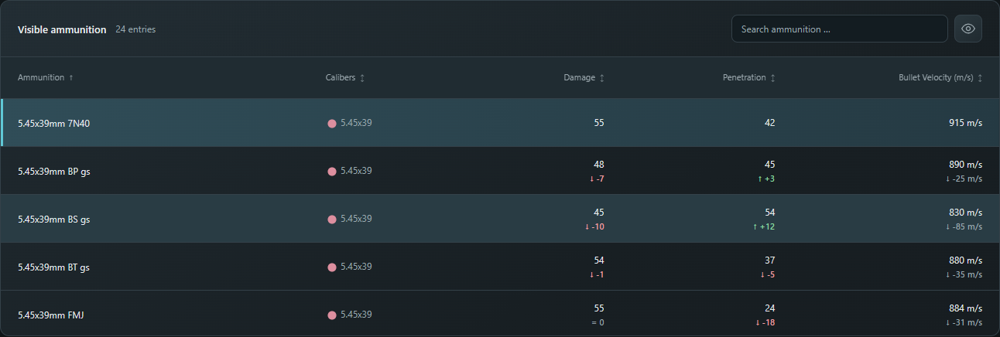

Numeric cells show the cartridge's value and, when a reference is selected, its difference from that reference. Search filters both the table and chart while the table is visible. The eye icon opens column selection; table headers control sorting.

In the code: `VisibleItems`, `OrderedColumns`, and `SortItems` in [AmmoGraphPage](../Web/AmmoGraphPage.razor), numeric cells in [TableValue](../Web/TableValue.razor), and column selection in [ColumnPicker](../Web/ColumnPicker.razor).

## Shots to Kill

Add **Shots to Kill · Armor Class N** under **Attributes and order**, then select it in either axis dropdown. The table has its own column picker. Classes reflect eligible loaded armor data; class 10 is excluded.

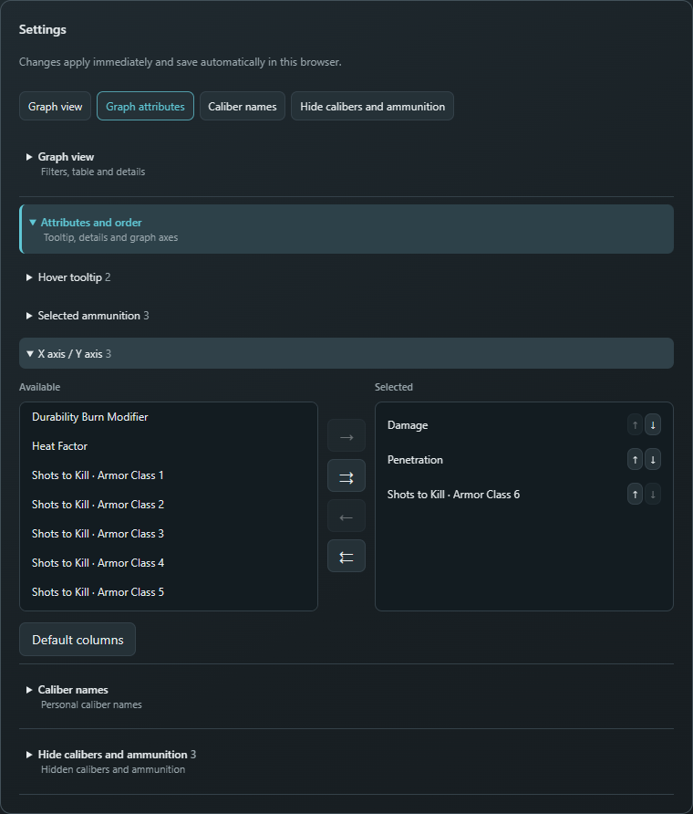

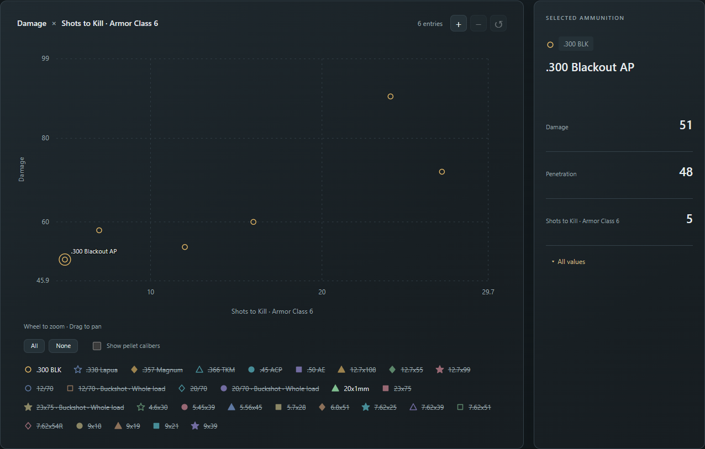

Lower shot counts are better. Only successful numeric results receive coordinates on an axis using Shots to Kill. The table keeps capped results as **100+**, without an additional graph notice. Such comparisons show direction without a numeric difference.

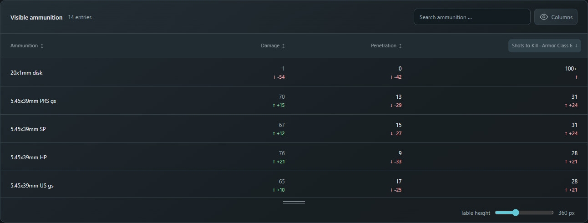

These are fixed reference calculations against an 85 HP chest target, separate from the interactive magazine settings. See [Shots to Kill](shots-to-kill.md) for averaging, success thresholds and the fixed buckshot assumptions.

In the code: [ShotsToKillEvaluation](../Core/ShotsToKill.cs) prepares and attaches results; [AmmoComparison](../Core/AmmoComparison.cs), [TableValue](../Web/TableValue.razor), and [ComparedValue](../Web/ComparedValue.razor) handle ordering and display.

## View settings

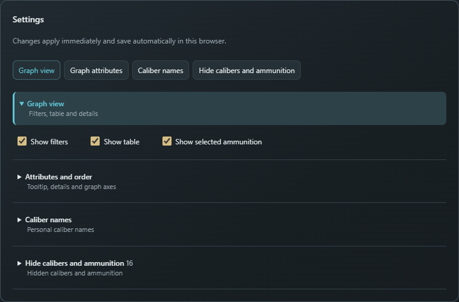

Use **Graph view** to show or hide the filter sidebar, table, and selected-ammunition panel. The remaining sections use the available space.

In the code: [ExclusionEditor](../Web/ExclusionEditor.razor) and the view toggles in [AmmoGraphPage](../Web/AmmoGraphPage.razor).

## Attributes and order

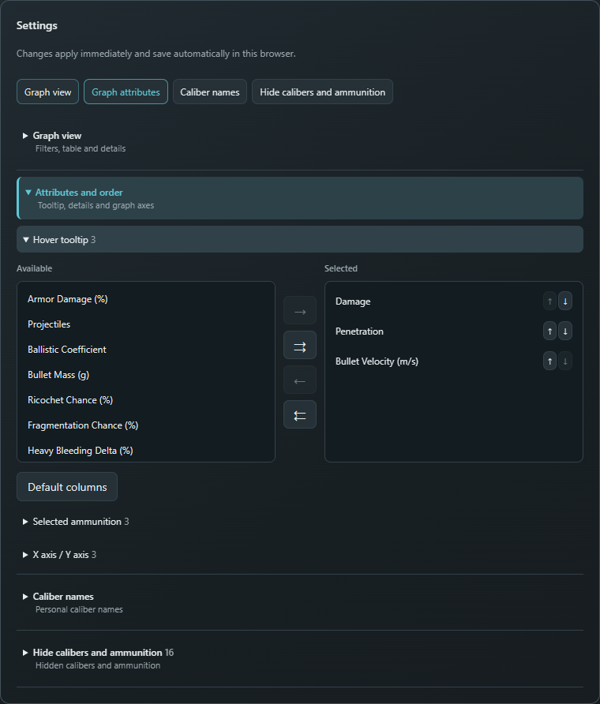

This section selects metrics for the tooltip, details panel, and both axis selectors. Available metrics are on the left; selected metrics are on the right. Buttons and drag and drop control membership and order.

In the code: [AttributePicker.razor](../Web/AttributePicker.razor) and [attribute-picker.js](../wwwroot/attribute-picker.js). `SetAttributes` on the main page applies the result.

## Personal caliber names

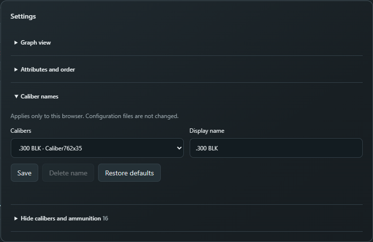

Visitors can assign their own display names here. **Delete name** suppresses the selected mapping in this browser. **Restore defaults** clears personal name changes and suppressions. The server file is preserved.

In the code: [CaliberNameEditor](../Web/CaliberNameEditor.razor), `SavePersonalName` and `EffectiveCaliberNames` in [AmmoGraphPage](../Web/AmmoGraphPage.razor), and overrides in [CaliberNameMap](../Core/CaliberNameMap.cs).

## Hide calibers and ammunition

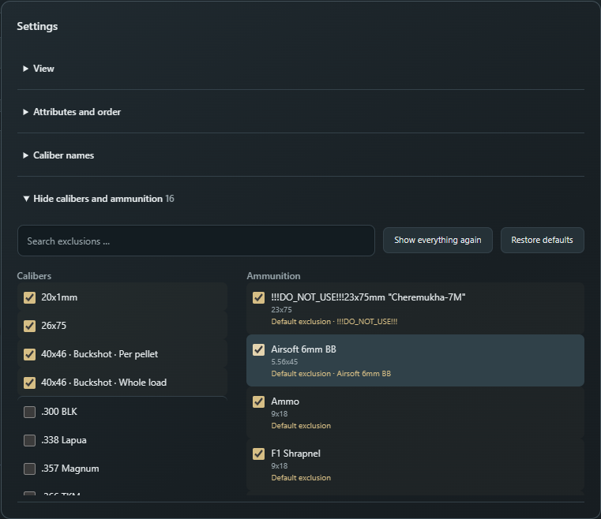

In these lists, a checked box means hidden. Entries hidden by default remain available and can be made visible again. The settings belong to the current browser.

In the code: [ExclusionEditor](../Web/ExclusionEditor.razor), exclusion state in [AmmoGraphPage](../Web/AmmoGraphPage.razor), and server defaults in [DefaultExclusions](../Core/DefaultExclusions.cs).

## Ballistics simulator

The header cartridge button replaces the chart, axis controls and selected-ammunition panel with a magazine editor, armor configuration and simulation diagram. Set the capacity from 1–100 rounds (default 30). The caliber filter becomes a single selection; the table adds Start/Middle/End actions. Capacity and equipment stay selected across calibers, and carriers with no replaceable plates are marked **(Only fixed insert)**. For buckshot, choose the average percentage of pellets hitting; at least one hits per shot. The graph button restores the previous graph view.

The diagram combines penetration rate and separate component durability lines on the percentage axis with damage bars on the HP axis. Shot labels begin at 1, with space before the first bar and after the last so edge markers remain visible. Zoom with the mouse wheel and drag to pan horizontally within that padded range. Both vertical scales remain fully visible, and hover/selection highlights keep their original width at every zoom level. The red vertical line marks the first shot where cumulative mean damage reaches 85 chest HP; **Show shots after death** reveals subsequent shots. Select a shot for statistical values and a reproducible example. See [the simulator guide](simulation.md) for controls, assumptions and calculation sources.

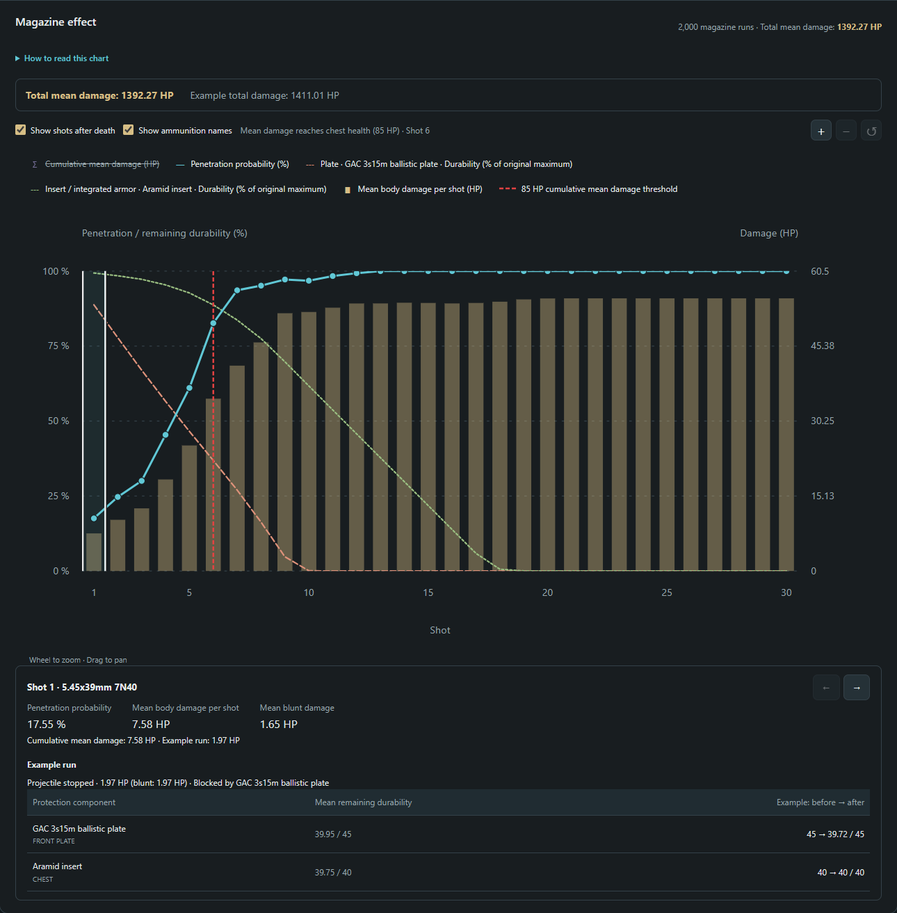

[Full magazine and armor configuration screenshot](images/simulation.png).

[Zoomed chart with constant-width selection and hover highlights](images/simulation-highlight-zoom.png).

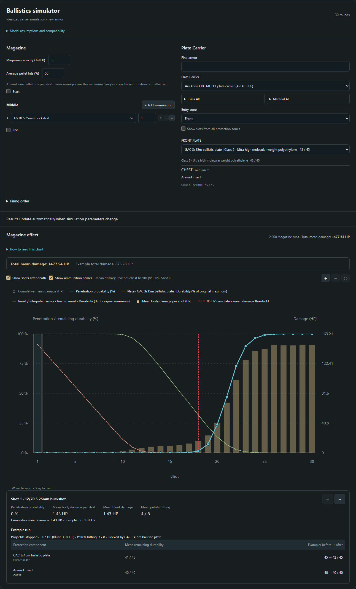
