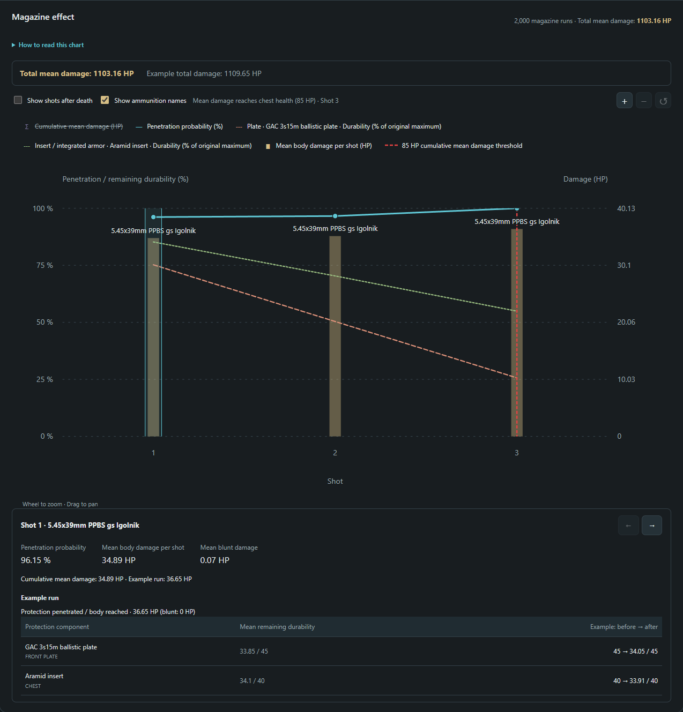
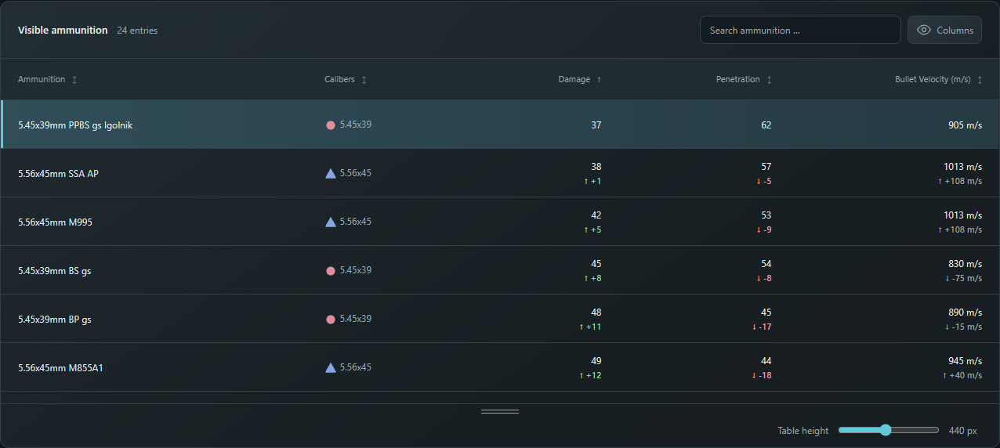

# Usability improvements

These changes address the moderated test observations in P1, P2, then P3 order. Ballistic formulas, simulation requests/results, ammunition models, random sampling, and existing series defaults are unchanged.

## Errors and automatic saving

Invalid magazine recipes and excluded ammunition have a red alert beside the magazine editor. Equipment errors appear beside the armor editor. Runtime errors remain until a corrected simulation succeeds and are kept separately for each caliber. Unrelated edits and translated labels do not clear an unresolved error. Personal-name errors also use red alert styling. As of 0.25.5, messages inside the ammunition graph and table use the same red styling, including empty selections, unmatched searches and missing graph attributes; their polite status announcements are preserved. Browser-native invalid number fields retain their validation behavior.

Settings still apply immediately. A compact status first reports **Applied · saving…**, then **Saved in this browser** only after cookie readback succeeds, including every chunk. Rapid edits share a 450 ms save timer and one notification. Successful feedback clears after 2.5 seconds. A failed save leaves a persistent red alert with **Retry saving**; later actions do not dismiss it. Pending changes flush on page exit. Explicit writes from another loaded preference module supersede a pending write.

The cookie names, UTF-8/Base64 encoding, chunk limits, expiry, browser isolation, and localStorage migration remain compatible. A saved `showNames: false` is respected. New optional fields are `simAmmoNames` (default `true`) and `tableHeight` (default `360`, validated from `160` to `760`). No manual save step was added to ordinary settings. Personal caliber names retain their existing explicit edit actions.

## Simulation diagram

The legend identifies penetration probability in %, durability in % of each layer's original maximum, mean body damage per shot in HP, cumulative mean damage in HP, and the red dashed 85 HP cumulative mean damage threshold. The threshold remains visible independently of which damage series is shown.

**How to read this chart** opens concise explanations of each quantity, the limitations of the 85 HP comparison, and mouse/keyboard shot selection. It explains that the marker is neither a kill probability nor a guarantee about an individual outcome.

**Show ammunition names** is enabled by default and saved independently of scatter-plot names. Names sit near the shot bars, retain their text size while zooming, shorten to fit, and disappear when less than useful space remains or a label would cross the plot boundary. Resizing and zooming recalculate their fit. Full names remain in tooltips and the keyboard-accessible shot details.

## Table and settings access

The table's lower edge has a drag handle. The same focused handle supports Up/Down in 20 px steps and Home/End for the limits. A labeled native height slider provides another keyboard and touch alternative. The preferred scroll-region height persists across views and reloads; its actual height is capped at 65% of the viewport, with a 160 px minimum. Table sorting, selection, sticky headers, and horizontal/vertical scrolling continue to use the existing table.

Magazine add actions are now the first simulator-table column. Its remove action removes that ammunition's start/end blocks and matching middle blocks through the existing recipe update path. An empty middle pattern shows the existing validation message.

The view toggle, settings menu, and column picker have visible localized labels alongside their icons. Header controls wrap on small screens. The settings dialog stays inside the viewport, including tablet widths. Category shortcuts and expanded-state accents expose the existing four accordions; **Graph attributes** also opens the attribute section directly from the graph toolbar.

## Defaults, localization, and validation

Visitors without saved preferences now start with scatter-plot names enabled. Colliding labels are suppressed while preserving the selected cartridge's label. Names are reevaluated after chart navigation and resizing; names can still be disabled.

All new text goes through `UiText` and the embedded `Resources/usability.json`, with complete entries for the existing 29 canonical translation catalogs. Existing locale aliases and English fallback remain in place. Core checks verify coverage and exact resource lookup for every new key.

The browser suite [tests/usability.mjs](../tests/usability.mjs) covers defaults, explicit false restoration, save feedback/failure/retry, existing settings categories, drag/keyboard/slider resizing, table selection and sorting, inline alerts in both themes, simulator navigation, legend units, contextual help, shot selection, crowded/zoomed labels, removal, 320/390/768 px layouts, and legacy migration. It uses fresh browser contexts. Existing simulator and navigation suites provide regression coverage; the hover test explicitly settles scrolling before asserting tooltip visibility.

See [testing.md](testing.md) for commands and [usability-validation.md](usability-validation.md) for the executed checks.
